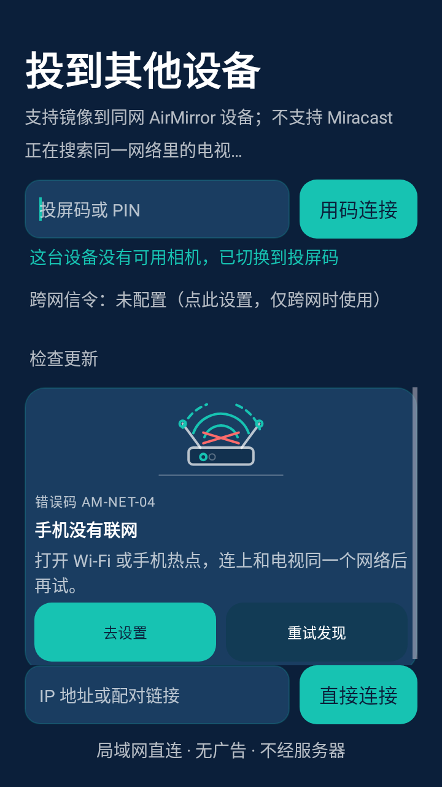
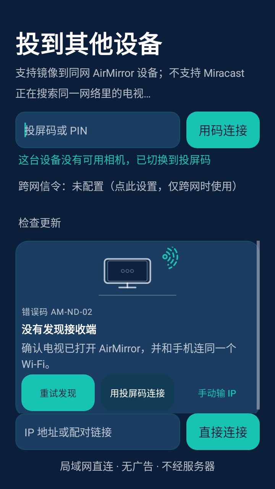

# AirMirror M1 自测与回归报告（T06107）

| 项 | 内容 |
| --- | --- |
| 日期 | 2026-11-24 |
| 分支 / 基线 | `main`；T06107 起点 `57d5905` |
| 范围 | M1 T06099～T06107 收口回归；重点 AC-01 / AC-06 / AC-08，关联 REQ-018 / REQ-023 / REQ-025 / REQ-006 / REQ-008 |
| 执行环境 | JDK 17 + Android SDK + Robolectric 4.13（SDK 34）；无真机/真实电视 |
| 全量基线 | **126 类 / 925 项 / 0 失败 / 0 错误 / 0 跳过**（2026-11-24 08:44） |
| 结论 | 本地渲染、逻辑与页面接线通过；飞行模式、AP 隔离、电视 3 米可读、摄像头与首帧时延仍需真机，转 T06115/T06129 |

## 1. 本轮改了什么

T06106 只交付了 `EmptyNetworkCheck` / `NetworkDiagnostics` 服务层，页面没有调用，飞行模式仍会显示“列表里没有设备”。T06107 把判决接到 `SenderActivity`：

- `renderEmptyState()` 先跑 `network.check(...)`，再回落到原 `EmptyDiagnosis`；`NO_NETWORK` / `NO_RECEIVER` 不再伪装成“搜索中”。
- 新增 15 秒空态窗口 `restartEmptyWindow()`；首次扫描与“重试发现”都会重置；`onDestroy` 移除回调。
- `NO_NETWORK` 的“去设置”接 `Settings.ACTION_WIRELESS_SETTINGS`；入口不存在时退回应用详情页。
- 新增 `SenderEmptyNetworkUiTest` 3 项；`ErrorStateCardUiTest` 矩阵从 3 原因扩到 5 原因，覆盖 360dp/720p/1080p。

> 0～15 秒仍保留 T06104 的“列表里没有设备”自救卡，这是首屏可操作入口；15 秒到点后才切 T06106 的最终原因 `NO_RECEIVER`。两者不是同一语义，报告中按“早期入口 / 最终诊断”区分。
>
> 兼容性说明：页面现在在搜索窗口开始时立即渲染空态，T06105 的 2 张入口截图因此重生成并带上 `AM-ND-01` 自救卡；T06104/主题/旧错误卡截图仅同版重生成，视觉内容未改版。

## 2. 全量测试

| 套件 | 结果 |
| --- | --- |
| 全量 `:app:testDebugUnitTest` | 126 类 / 925 项 / 0 失败 / 0 错误 / 0 跳过 |
| `EmptyNetworkCheckTest` | 11 / 0 失败 |
| `NetworkDiagnostics` 相关 | 由 `EmptyNetworkCheckTest` 与页面测试覆盖 |
| `ErrorNoticeTest` + `ErrorVisualSpecTest` | 13 + 6 / 0 失败 |
| `ThemeRenderEvidenceTest` | 3 / 0 失败 |
| `ThemeTokenGuardTest` | 9 / 0 失败 |
| `TvLayoutUiTest` | 7 / 0 失败 |
| `SenderEmptyStateUiTest` + `SenderTwoStepUiTest` + `SenderEmptyNetworkUiTest` | 6 + 4 + 3 / 0 失败 |
| `ErrorStateCardUiTest` | 3 个测试方法，循环 5 原因 × 3 尺寸 / 0 失败 |

测试命令：

```text
./gradlew :app:testDebugUnitTest --offline --no-daemon --no-watch-fs \
  --project-cache-dir <cache> --console=plain
```

## 3. AC-01：空态原因与 360dp/1080p 无截断

| 场景 | 证据 | 结果 |
| --- | --- | --- |
| 飞行模式 / 无链路 | 页面 360dp：`sender-empty-no-network-360dp-20261124.png` | 显示 `手机没有联网`、`错误码 AM-NET-04`、`去设置`、`重试发现`；通过（Robolectric 置空 `activeNetworkInfo` 模拟） |
| 15 秒无接收端 | 页面 360dp：`sender-empty-no-receiver-360dp-20261124.png` | 显示 `没有发现接收端`、`错误码 AM-ND-02`、三动作；通过（可控时钟 20s / startedAt=1s） |
| 接收端离线 | `error-offline-360dp-20261123.png` 等 | `AM-OFF-01`，三动作；通过（T06101/T06104 既有证据） |
| 360dp / 720p / 1080p 组件矩阵 | `error-no-network-*` / `error-no-receiver-*` 各 3 档 | 顶部/底部安全区不裁切、动作数量按原因渲染、无异常/包名/堆栈；通过 |
| 真实飞行模式 / AP 隔离 | — | **未验证**，归 T06115/T06129 |





1080p 组件卡：`assets/error-states-20261123/error-no-network-1080p-20261123.png`、`assets/error-states-20261123/error-no-receiver-1080p-20261123.png`。

## 4. AC-06：TV 截屏矩阵

`TvLayoutUiTest` 7 项全部通过，截图已归档到 `assets/m1-regression-20261124/tv-matrix/`：

| 尺寸 | 截图 | 断言 |
| --- | --- | --- |
| 1280×720 | `tv-layout-720p-waiting-20261123.png` | 64dp 左右安全区、二维码 245px、正文 ≥24px、底部不裁切 |
| 1920×1080 | `tv-layout-1080p-waiting-20261123.png` | 96dp 左右安全区、二维码 368px、并排不溢出 |
| 1024×768（4:3） | `tv-layout-4x3-waiting-20261123.png` | 64dp 安全区、二维码 262px、无横向裁切 |
| 2560×1080（21:9） | `tv-layout-21x9-waiting-20261123.png` | 128dp 安全区、并排内容不超安全区 |
| 长设备名 | `tv-layout-1080p-long-name-20261123.png` | 20 字符名最多两行，不压设置入口/二维码 |
| 1080p 设置 / 入口 | `tv-layout-1080p-settings` / `-entry` | 正文 ≥24px、安全区、焦点顺序基线 |


**边界**：以上是 Robolectric 像素布局，不等同于电视 3 米可读、真实 overscan、D-pad/TalkBack 实测；这些仍归 T06115。

## 5. AC-08：主题像素与硬编码颜色

- 17 组旧色值与三层令牌逐像素比较：**0 差异**（要求 ≤1%）。
- `ThemeTokenGuardTest` 9 项通过：UI 目录除 `ThemeTokens.kt` 外无 `0x[0-9A-Fa-f]{8}` 色值、无 `textSize` 字面量、无通用 dp 刻度字面量、无动效时长字面量。
- 360dp / 1080p 主题预览均从真实 `ThemePreviewView` 渲染，不是设计稿占位。
- 默认主题像素等价差异：**0.00%**。


360dp / 1080p 全长预览见 `assets/m1-regression-20261124/theme/`。

## 6. 首投路径

| 检查点 | 证据 | 结果 |
| --- | --- | --- |
| 入口优先级 | `TwoStepCastPolicyTest` 9 项 | 本机上次首帧成功设备 > 同网列表 > 扫码 > 投屏码 |
| 唯一在线自动选中 | 同上 + `SenderTwoStepUiTest` | 两台在线返回 null；用户手动改入口/已尝试/连接中不抢 |
| 首帧成功才写记忆 | `LastCastTargetTest` 3 项 | 30 天有效；失败/取消不写 |
| 扫码回退 | `QrPhotoScanTest` 4 项、`SenderTwoStepUiTest` 4 项 | 系统相机 + 本地 ZXing；无相机/失败切投屏码；不申请 CAMERA |
| 决策预算 | `SenderTwoStepUiTest` | 扫码/切码/展开/选镜像共 2 次；自动 0 次 |
| 端到端首帧 | — | **未验证**；相机 ROM 差异、扫码→首帧 ≤15s、自动选中→首帧 ≤10s、电视确认 ≤5s 归 T06115 |

## 7. 缺陷与残留风险

| ID | 级别 | 状态 | 描述 | 处置 |
| --- | --- | --- | --- | --- |
| D-01 | P0 | 已修复 | T06106 服务未接页面，飞行模式不显示 `NO_NETWORK` | T06107 接线 + `SenderEmptyNetworkUiTest` 3 项 + 页面截图 |
| D-02 | P1 | 待现场 | 飞行模式/AP 隔离只有 Robolectric 模拟，无真机日志与截图 | T06115/T06129 |
| D-03 | P1 | 待现场 | 电视 3 米可读、真实 overscan、遥控器焦点顺序未实测 | T06115 |
| D-04 | P2 | 口径确认 | 0～15 秒仍显示 T06104 `NO_DISCOVERY` 自救卡，15 秒后才切 `NO_RECEIVER` | 保留首屏可操作入口；若产品要求“15 秒前不下结论”，另开交互改造，不放 T06107 偷改 |
| D-05 | P3 | 观察 | 无网络时顶部状态行仍写“正在搜索同一网络里的电视…” | 与主卡原因并存；下一轮视觉走查决定是否隐藏状态行 |
| D-06 | P1 | 待现场 | 真实相机 `EXTRA_OUTPUT`、扫码→首帧、自动选中→首帧、电视首次确认均无实测 | T06115 |

## 8. 结论

- M1 代码与本地回归闭环：全量 **126 类 / 925 项全绿**，新增空态网络页面测试 3 项，空态视觉矩阵扩到 5 原因 × 3 尺寸。
- AC-08 **通过**；AC-01 / AC-06 的渲染与逻辑部分 **通过**，现场部分 **未通过/未验证**，不能按“端到端验收通过”回传。
- T06107 交付 M1 测试报告与缺陷清单；T06115 承接真机联调，T06129 承接发布回归。M1 阶段可进入 M2 联调前置，真机缺口不隐藏。
