# AirMirror × One UI 7 视觉风格评估报告

- 任务：**T05758 评估 AirMirror 参考 One UI 7 风格并在模拟器中视觉调试**
- 日期：2026-11-15（评估）/ 2026-11-16（T05759 实施后复核）
- 被测包：`AirMirror-0.1.0-m0-universal-debug.apk`（6.73 MB，Material Components 按钮改造版，对应提交 `acde74f`）；T05759 复核包 `AirMirror-0.1.0-m0.20261116-001-universal-debug.apk`
- 评估范围：**仅视觉层面**（色彩、字阶、圆角、阴影/模糊、间距、组件形态、多尺寸适配、动效观感）；不含功能开发、性能与业务逻辑改动
- 一句话结论：**初评适配度 = 中（55/100）；T05759 实施 P0/P1 后复核 = 72/100（中上）**。不建议全面替换，建议局部引入 One UI 7 的“圆角一致性 + 柔和层次 + 组件形态”，保留 AirMirror 深蓝/青绿品牌色与 TV 可读性口径。

---

## 1. 结论摘要

| 项目 | 结论 |
|---|---|
| 整体适配度 | **中（55/100）**；结构（间距、字阶、按钮统一）已具备基础，材质（阴影/模糊）与形态（卡片/弹窗直角）是主要短板 |
| 是否建议全面引入 One UI 7 | **否**。全面替换会推翻现有品牌识别、TV 3 米可读字号与二维码可靠性口径，改造面大、收益低于成本 |
| 是否建议局部引入 | **是**。优先做三件事：① 统一圆角体系（卡片/弹窗/面板与按钮同语言）；② 建立“背景→面→浮层”的柔和层次（含模糊降级方案）；③ 修复诊断卡三动作文字裁切 |
| 多尺寸兼容性 | 1080×2340@440 / 1080×2400@320 / 1440×3200@480 三档均可正常渲染，无整体错位、图标失真；**发现 1 处文字裁切（393dp 宽诊断卡）和 1 处浮层背景穿透（320dpi）** |
| 本轮代码改动 | 初评阶段**无**；T05759 已实施 P0/P1（诊断卡纵向、设置全屏遮罩、圆角令牌、Material 弹窗、主入口 24dp 间距、分组标题字阶） |

---

## 2. 评估范围与方法

### 2.1 环境与设备

| 项 | 值 |
|---|---|
| 模拟器 | AVD `airmirror_oneui`（按要求创建于 `E:\Android\avd`，Pixel 5 设备档） |
| 系统镜像 | `system-images;android-34;google_apis;x86_64`（Android 14） |
| 启动方式 | headless `-no-window -gpu swiftshader_indirect`，冷启动 66s 完成 |
| 屏幕配置 1（基线） | 1080×2340 @ 440dpi → **393dp 宽**（主流窄手机） |
| 屏幕配置 2 | 1080×2400 @ 320dpi → **540dp 宽**（大屏/低密度） |
| 屏幕配置 3 | 1440×3200 @ 480dpi → **480dp 宽**（2K 高密度长屏） |
| 采集方式 | `adb screencap` 原图；页面跳转用 `uiautomator dump` 文本定位点击，避免坐标硬编码 |
| 覆盖页面 | 主入口、发送端（含设备卡/诊断卡/更新弹窗）、接收端（引导卡/待连接页）、显示设置（上/下半屏） |

> 说明：模拟器统一创建在 `E:\Android` 下（`ANDROID_AVD_HOME=E:\Android\avd`），未使用默认 `C:\Users\...\.android\avd`。

### 2.2 证据文件

截图目录：`docs/assets/oneui7-eval/`

| 文件 | 内容 | 用途 |
|---|---|---|
| `01-main-1080x2340-440.png` | 主入口（基线） | 按钮间距、品牌区、留白 |
| `02-sender-1080x2340-440.png` | 发送端（基线，含诊断卡） | **P0 文字裁切证据** |
| `03-receiver-1080x2340-440.png` | 接收端待连接页 | 二维码、码环、层级 |
| `04-settings-top-1080x2340-440.png` / `05-settings-bottom-1080x2340-440.png` | 显示设置上/下半屏 | 字阶、分组、底部操作 |
| `receiver-onboarding-1080x2340-440.png` | 接收端引导卡 | **直角卡片与圆角按钮冲突证据** |
| `sender-dialog-1080x2340-440.png` | 更新弹窗（基线） | **系统 AlertDialog 风格冲突证据** |
| `main-1080x2400-320.png`、`sender-1080x2400-320.png`、`receiver-1080x2400-320.png`、`settings-top-1080x2400-320.png`、`settings-bottom-1080x2400-320.png` | 540dp 宽配置 | 兼容性 |
| `sender-diagnostic-1080x2400-320.png` | 540dp 宽断网态 | 空列表留白与诊断态可见性 |
| `main-1440x3200-480.png`、`sender-1440x3200-480.png`、`receiver-1440x3200-480.png`、`settings-top-1440x3200-480.png`、`settings-bottom-1440x3200-480.png` | 480dp 宽 2K 配置 | 兼容性、纵向平衡 |
| `sender-dialog-1080x2400-320.png`、`sender-dialog-1440x3200-480.png` | 更新弹窗在另两档密度 | 弹窗自适应 |

---

## 3. 现状视觉盘点（源码事实）

### 3.1 色彩

| 令牌 | 值 | 角色 |
|---|---|---|
| `BACKGROUND` | `#0B1F3A` | 全局深海军蓝底 |
| `SURFACE` | `#12314F` | 卡片/输入框/次按钮面 |
| `ACCENT` | `#17C3B2` | 主行动、连接态、投屏码 |
| `TEXT_PRIMARY` | `#FFFFFF` | 标题/主文案 |
| `TEXT_SECONDARY` | `#B3FFFFFF`（70% 白） | 副标题/说明 |
| `OFFLINE` | `#4DFFFFFF`（30% 白） | 离线态 |
| `DANGER` | `#FF6B6B` | 错误 |
| 派生 | `BACKGROUND_ALPHA_40/80/90`、`SURFACE_ALPHA_90`、`DIVIDER #3312314F`、`QR_BACKGROUND #FFFFFF` | 遮罩/分隔/二维码底 |

评价：色板克制、语义清晰，深底高对比在投屏场景可读性稳定；但整体是**高饱和深色 + 单一青色强调**，与 One UI 7 的“轻盈、低饱和、多层中性色”取向不同。

### 3.2 字阶

| 令牌 | 值 | 适用 |
|---|---|---|
| `TITLE_SP` | 40sp | TV 页标题 |
| `PHONE_TITLE_SP` | 32sp | 手机页标题（发送端已与此对齐） |
| `SENDER_TITLE_SP` | = 32sp | 兼容别名 |
| `BODY_SP` | 24sp | TV 正文 |
| `PHONE_BODY_SP` | 14sp | 手机正文/说明 |
| `DEVICE_NAME_SP` | 18sp | 设备名 |
| `CODE_SP` | 36sp | 6 位投屏码（环内单行） |
| `PHONE_BUTTON_SP` / `BUTTON_SP` | 16 / 24sp | 手机 / TV 按钮 |

评价：上一轮“按角色拉齐字号”的成果明显，页面标题已统一 32sp；短板是**正文字号不随屏宽/密度自适应**，在 480dp 宽 2K 屏上 14sp 显得偏小、行宽过长。

### 3.3 形态与圆角

| 元素 | 现状 | 来源 |
|---|---|---|
| 按钮 | **14dp 圆角**（MaterialButton，手机高 48dp / TV 56dp） | `Theme.RADIUS_BUTTON_DP`、`UiKit.button` |
| 焦点描边 | 6dp 圆角 | `Theme.RADIUS_FOCUS_DP` |
| 协议角标 | 10dp 圆角 | `DeviceCardPolicy.TAG_RADIUS_DP` |
| 设备卡 / 诊断卡 / 引导卡 / 设置面板 | **0dp（直角纯色块）** | 各 Activity 直接 `setBackgroundColor(Theme.SURFACE)` |
| 更新弹窗等 | **系统 `AlertDialog`**（直角、灰面、系统默认内边距） | `AlertDialog.Builder` |
| 二维码 | 直角白底（扫码可靠性优先） | `QR_BACKGROUND` |

评价：**同一个页面里同时存在 14dp 圆角按钮和 0dp 直角卡片**，是当前最明显的风格断裂。

### 3.4 间距与网格

- 刻度：`4 / 8 / 12 / 16 / 24 / 32dp`
- 主入口根 padding 24dp、顶部 56dp；两个主按钮间距 16dp（实测 440dpi 下 44px）
- 并排“输入框 + 按钮”统一 8dp；卡片内 padding 8dp（诊断卡）
- 接收端待连接页 padding 32 / 28 / 32 / 24dp；码槽 190dp、二维码 120dp

评价：**4/8 网格执行得最好**，与 One UI 7 的宽松留白方向一致，是本次评分中的最高项。

### 3.5 层次、材质与动效

- `elevation` / `RenderEffect` / `setShadowLayer` 在 `ui/*.kt` 中 **0 处命中**：全平面、无阴影、无模糊。
- 卡片、提示条、设置面板均为纯色块，层级只靠颜色明度差（`#0B1F3A` vs `#12314F`）。
- 动效：焦点 120ms、连接淡入 200ms、换码 150ms；无弹性/缩放反馈。

评价：与 One UI 7 强调的“柔和景深、模糊层次、顺滑动效”差距最大；也是“看起来像深色工具，而不是 One UI 7”的核心原因。

---

## 4. One UI 7 设计基线（官方口径）

三星官方对 One UI 7 的公开描述集中在四点：

1. **曲线与圆形语言**：按钮、菜单、通知、控制栏大量采用圆角与圆形元素，整体更圆润。
2. **全新配色**：更轻盈、层次更柔和的色彩体系。
3. **模糊与层次**：One UI 7 独有模糊效果，让信息层级更清晰。
4. **柔和动画**：过渡更顺滑，强调“简洁、单手可用”。

同时，官方设计指南强调**屏幕边缘/圆角处留边、按钮周边留足 margin**，避免内容顶到圆角屏边缘。

参考：

- Samsung One UI 7 官方特性页：<https://www.samsung.com.cn/one-ui/features/>
- One UI Design Guide（官方 PDF）：<https://design.samsung.com/global/contents/one-ui/download/oneui_design_guide_eng.pdf>

> 说明：One UI 7 具体组件的 dp 值官方未逐一公开，本报告按其**定性特征**（圆角一致性、柔和层次、模糊、字重层级、单手布局）做对比，不虚构精确数值。

---

## 5. 逐项对比

| 维度 | AirMirror 现状 | One UI 7 取向 | 判定 |
|---|---|---|---|
| 色彩体系 | 深海军蓝 + 青绿高对比，语义色齐全 | 轻盈低饱和、多中性层、少量强调色 | **部分适配需微调**：品牌色可保留，但需补中性层与降低整体硬度 |
| 字体与字阶 | 角色化字阶已统一（标题 32、正文 14、按钮 16） | 强字重对比、标题更大、正文更舒展 | **部分适配需微调**：字阶结构合格，缺响应式字号与字重层次 |
| 圆角/形态 | 按钮 14dp；卡片/面板/弹窗 0dp | 圆角/圆形贯穿所有容器 | **存在冲突**：同页形态语言不统一 |
| 阴影/模糊 | 全平面，无 elevation、无 blur | 柔和景深 + 模糊分层 | **存在冲突**：层级只能靠色块明度 |
| 间距网格 | 4/8/12/16/24/32，24dp 页边距 | 宽松留白、边缘留边 | **完全契合** |
| 按钮 | MaterialButton 统一，14dp 圆角、48dp 高、16sp | 胶囊/圆角、明确主次 | **部分适配需微调**：形态已接近，弱行动仍用文字按钮 |
| 卡片/面板 | 直角 `SURFACE` 纯色块 | 大圆角、轻描边/柔和面 | **存在冲突** |
| 对话框 | 系统 AlertDialog：灰面、直角、正文 18sp、按钮纯文字 | 圆角对话框/底部 sheet、正文克制、按钮胶囊 | **存在冲突** |
| 设置页 | 单列平铺、无分组卡、按钮跟在内容末尾 | 分组卡片、分区标题、固定底部操作 | **部分适配需微调** |
| 图标 | 基本无图标体系，“显示设置”等为纯文字入口 | Rounded 图标 + 文字，图标承担识别 | **存在冲突** |
| 多尺寸适配 | 三档均可渲染；393dp 诊断卡裁切、320dpi 浮层穿透 | 边缘留边、响应式布局 | **部分适配需微调** |
| 动效 | 120/150/200ms 淡入淡出 | 柔和、略带弹性的过渡 | **部分适配需微调** |
| 单手可达 | 48dp 触控目标达标；高屏底部操作偏远 | 单手可达、底部操作集中 | **部分适配需微调** |

---

## 6. 视觉调试日志

### 6.1 配置矩阵与结果

| 配置 | dp 宽 | 主入口 | 发送端 | 接收端 | 设置 | 弹窗 |
|---|---|---|---|---|---|---|
| 1080×2340@440 | 393dp | 正常 | **诊断卡三动作文字裁切（P0）** | 正常 | 正常（可滚动） | 直角灰面、正文偏大 |
| 1080×2400@320 | 540dp | 正常，留白更大 | 正常（有设备卡时无裁切） | 正常 | **顶部露出底层设备名并被裁切（P1）** | 直角灰面，自适应可读 |
| 1440×3200@480 | 480dp | 正常，但内容偏上、底部空白大 | 正常 | 正常，二维码/码环视觉权重偏小 | 正常，正文 14sp 偏小、行宽过长 | 直角灰面，正文偏大 |

补充：断网态（540dp）发送端不出现诊断卡，空列表留白很大；说明诊断卡只在“搜索无结果”时出现，偶发但一旦出现即影响自救路径。

### 6.2 问题清单

#### V-01（P0）诊断卡三动作文字换行、底部被裁切

- 证据：`02-sender-1080x2340-440.png`（发送端「网络禁止设备互访」卡）
- 现象：卡内「重试发现 / 用投屏码连接 / 手动输 IP」三等分横排，16sp 文案在约 100dp 宽按钮内换行；「用投屏码连接」第二行只露半个字，「手动输 IP」第二行被卡片底边裁掉。
- 代码事实：`SenderActivity.buildDiagnosisCard()` 卡片 padding 8dp、三按钮 `weight=1`、`UiKit.button` 水平 padding 16dp、`minimumHeight=48dp`；393dp 屏宽下按钮可用文本宽度约 70dp，6 字标签必然换行，而按钮高度未按两行文本扩展。
- 影响：这是空列表自救路径，文字不可读直接影响用户能否恢复连接；也是本轮唯一“功能性可读性”级别的视觉缺陷。
- 建议：三动作改**纵向全宽按钮**（Ghost/Secondary，48dp 高、8dp 间距），或改为“主按钮 + 两个文字链接”两层；保证 `maxLines=1`、`ellipsize=END`，并在 320/393/480dp 三档截图验收。

#### V-02（P1）圆角语言断裂：按钮圆、卡片直

- 证据：`receiver-onboarding-1080x2340-440.png`、`04-settings-top-1080x2340-440.png`
- 现象：14dp 圆角按钮悬浮在 0dp 直角卡片/面板上，像两套设计系统拼接。
- 建议：建立统一圆角令牌：卡片 16dp、内嵌块 12dp、对话框 24dp、按钮保持 14dp（或统一 16dp）；`setBackground` 改 `GradientDrawable` 圆角 + `SURFACE` 填充；TV 端保持 16dp 不变。

#### V-03（P1）更新弹窗为系统 AlertDialog，与品牌/One UI 7 均不协调

- 证据：`sender-dialog-1080x2340-440.png`
- 现象：直角、灰色面板（非品牌 navy/surface）、正文 18sp 行宽过大、按钮“稍后 / 下载并安装”为右下纯文字，缺少主次按钮形态。
- 建议：改 `MaterialAlertDialogBuilder` + 自定义主题：24dp 圆角、`SURFACE` 面、正文 14sp、按钮改为“稍后（Ghost）+ 下载并安装（Primary）”横排胶囊；长文案拆条列点，限制行宽 36 字。

#### V-04（P1）全平面无层次，缺 One UI 7 的柔和景深/模糊

- 证据：所有截图；代码 `ui/*.kt` 中 elevation/blur 0 命中
- 现象：背景、卡片、面板只靠明度差区分，浮层（设置面板）与背景贴合，缺少“浮起来”的层级感。
- 建议：三层表面令牌（background / surface / surface-elevated），卡片加 1dp 低对比描边或 2dp 柔和阴影；顶部栏与弹窗遮罩用 blur（Android 12+ `RenderEffect`，低版本降级为半透明 scrim）；模糊强度与遮罩透明度做成令牌，避免各家 ROM 差异。

#### V-05（P1）设置浮层未铺满，底层设备名从顶部露出并被裁切（320dpi）

- 证据：`settings-top-1080x2400-320.png`（顶部可见 `sdkgphone64x-06` 被切一半）
- 现象：设置面板从状态栏下方开始，未盖住底层接收页标题；540dp 宽配置下最明显，480dp 下被面板覆盖。
- 建议：设置面板改全屏 overlay（含状态栏区域 padding），或加统一 scrim 并把底层内容整体下移/隐藏；面板顶部增加 24dp 安全边距。

#### V-06（P2）高长屏内容偏上、纵向失衡

- 证据：`main-1440x3200-480.png`、`receiver-1440x3200-480.png`
- 现象：1440×3200@480 下，主入口内容集中上半屏，底部约 1/3 空白；接收端二维码 + 码环视觉权重偏小，未形成视觉中心。
- 建议：手机端主入口改垂直居中（或在 >900dp 高时按比例分配上下留白）；接收端把二维码/码环组合整体居中，码槽随屏高在 190–240dp 区间响应式放大；TV 端维持顶部对齐。

#### V-07（P2）大屏正文偏小、行宽过长

- 证据：`settings-top-1440x3200-480.png`、`05-settings-bottom-1080x2340-440.png`
- 现象：设置页正文 14sp 在 480dp 宽 2K 屏上偏小，说明文字整行铺满，阅读疲劳。
- 建议：按屏宽分档：`<400dp` 14sp、`400–599dp` 15sp、`≥600dp` 16sp；正文最大行宽 36–40 字，长说明改两行内短句。

#### V-08（P2）设置页为单列平铺，缺分组与固定底部操作

- 证据：`04/05-settings` 系列
- 现象：显示模式、开关、信令、画质、隐私全部同一直列，仅靠 24dp 间距分段；“完成”按钮跟在滚动内容末尾，长列表需滚到底才能提交。
- 建议：改 2–3 个圆角分组卡（显示 / 网络与画质 / 隐私），组标题 18sp 粗体；底部“完成”改为固定 bottom bar（Primary 全宽 + 上方 16dp 渐变遮罩）。

#### V-09（P2）缺少统一图标体系

- 证据：主入口、接收端、设置页均为纯文字入口；“显示设置”“更多信息”无图标。
- 建议：引入一套 Rounded 线性图标（Material Symbols Rounded 或自绘 SVG），统一 24dp、2dp 描边；文字入口改“图标 + 文字”胶囊，TV 端图标放大到 32dp。

#### V-10（P2）动效单一，无按压/层级反馈

- 现状：焦点 120ms、连接淡入 200ms、换码 150ms；无按压缩放、无弹性。
- 建议：按压 scale 0.98 / 120ms、浮层进入 240ms `FastOutSlowIn`、连接成功 300ms 轻微上浮；保留“减少动态效果”开关，C 级设备继续归零。

### 6.3 兼容性专项结论

| 检查项 | 结果 |
|---|---|
| 布局错位 | 三档均无整体错位；主入口按钮、输入框+按钮、设置页栅格稳定 |
| 文字截断 | 仅 V-01（393dp 诊断卡）；其余页面三档均完整 |
| 图标/图形失真 | 无；二维码始终正方形、纯白底可扫；码环保持正圆 |
| 触控目标 | 按钮最小 48dp，达标；卡片动作行 48dp |
| 浮层遮挡 | V-05（320dpi 设置面板顶部穿透） |
| 纵向平衡 | 480dp 长屏偏上（V-06） |
| 字号可读性 | 480dp 宽下 14sp 偏小（V-07） |

---

## 7. 适配度评分

权重按“视觉改造收益 / 用户感知强度”分配：

| 维度 | 权重 | 得分（1–5） | 加权 |
|---|---:|---:|---:|
| 色彩体系与品牌一致性 | 15% | 3 | 0.45 |
| 形态与圆角语言 | 15% | 2 | 0.30 |
| 层次/材质（阴影、模糊） | 10% | 1 | 0.10 |
| 字体与字阶 | 15% | 3 | 0.45 |
| 间距与对齐 | 10% | 4 | 0.40 |
| 多尺寸/DPI 适配 | 15% | 3 | 0.45 |
| 组件一致性（按钮/卡片/弹窗） | 10% | 3 | 0.30 |
| 动效与反馈 | 5% | 3 | 0.15 |
| 单手可达/可访问性 | 5% | 3 | 0.15 |
| **合计** | **100%** | — | **2.75 / 5 → 55/100** |

**评级：中。**

- 加分项：间距网格执行到位（4/5）；按钮已统一走 Material Components，主次分明；字号按角色统一；三档分辨率均可正常渲染。
- 扣分项：层次/材质几乎空白（1/5）；圆角语言断裂（2/5）；卡片/弹窗仍是系统默认形态；大屏适配偏“能显示”而非“好看”。
- 若以 One UI 7 为 100 分基准，当前视觉还原度约 **55 分**：骨架接近，表皮与材质未到位。

---

## 7.1 T05759 实施后复核（2026-11-16）

### 7.1.1 已落地改动

| 问题 | 状态 | 实现 |
|---|---|---|
| V-01 诊断卡三动作裁切（P0） | **已修复** | 三动作改纵向全宽，每项 48dp 高、8dp 间隔，`maxLines=1` + `ellipsize=END`；393/540/480dp 三档截图均无换行/裁切 |
| V-02 圆角语言断裂（P1） | **已修复** | 新增卡片 16dp / 内嵌块 12dp / 弹窗 24dp 令牌；`UiKit.surface`/`inset` 统一圆角面 + 1dp 低对比描边 + 轻 elevation；发送端控制栏、接管条、输入框、设备卡、诊断卡与接收端设置入口、授权条、结束条、引导卡全部接入 |
| V-03 更新弹窗系统 AlertDialog（P1） | **已修复** | 三个页面弹窗统一切 `UiKit.dialog`（`MaterialAlertDialogBuilder` + `ThemeOverlay.AirMirror.Dialog`）；正文 14sp，正向按钮实底青绿、负向 Ghost。实机截图见 `after-update-dialog-1080x2400-320.png`（540dp，降版本触发真实 GitHub Release 弹窗） |
| V-04 全平面无层次（P1） | **部分修复** | 新增 `SURFACE_ELEVATED #1A3D61`、`SURFACE_STROKE #3317C3B2`；卡片有轻 elevation + 描边。One UI 7 的 blur/柔和景深仍未做（P2 级） |
| V-05 设置浮层顶部穿透（P1） | **已修复** | 设置滚动区包进全屏不透明 `settingsOverlay`，显示设置时遮罩 + 面板同时可见；顶部 padding 24dp；320dpi 截图顶部不再露出底层设备名 |
| V-06 高长屏纵向失衡（P2） | **部分修复** | 主入口手机端改垂直居中（TV 保持顶部对齐）；接收端二维码/码环未做响应式放大 |
| V-07 大屏正文偏小（P2） | **未实施** | 14/15/16sp 响应式分档、正文限宽仍未做；480dp 设置页正文仍 14sp |
| V-08 设置页单列平铺（P2） | **部分修复** | 分组标题新增 `SECTION_TITLE_SP=18sp`（TV 24sp），“隐私”不再复用 32sp 页面标题；三组圆角分组卡未做，底部“完成”按钮在高屏可见、长列表仍需滚动 |
| V-09 图标体系（P2） | **未实施** | 仍为纯文字入口 |
| V-10 动效升级（P2） | **未实施** | 仍为 120/150/200ms 淡入淡出 |

补充：主入口两个主按钮上下间距由 16dp 增至 **24dp**，回应用户“两个按钮距离过近”；手机端根布局垂直居中。

### 7.1.2 三档回归证据

| 配置 | dp 宽 | 主入口 | 发送端诊断卡 | 显示设置 |
|---|---|---|---|---|
| 1080×2340@440 | 393dp | `after-main-1080x2340-440.png`：24dp 间距、垂直居中 | `after-sender-1080x2340-440.png`：纵向三按钮、无裁切 | `after-settings-1080x2340-440.png`：全屏面板、顶部无穿透 |
| 1080×2400@320 | 540dp | `after-main-1080x2400-320.png`：居中、留白均衡 | `after-sender-1080x2400-320.png`：纵向三按钮、无裁切 | `after-settings-1080x2400-320.png`：顶部无底层设备名、底部“完成”可见；`after-update-dialog-1080x2400-320.png`：24dp 圆角、品牌面、Ghost/Primary 按钮 |
| 1440×3200@480 | 480dp | `after-main-1440x3200-480.png`：居中、上下留白均衡 | `after-sender-1440x3200-480.png`：纵向三按钮、无裁切 | `after-settings-1440x3200-480.png`：全屏面板、底部“完成”可见 |

实测坐标（393dp 发送端，`uiautomator dump`）：

- 诊断卡：`[77,1052][1003,1514]`
- 三按钮：`[77,1074][1003,1206]`、`[77,1228][1003,1360]`、`[77,1382][1003,1514]`（均满宽、单行、无底部裁切）

### 7.1.3 复核评分

| 维度 | 权重 | 初评 | 复核 | 加权 |
|---|---:|---:|---:|---:|
| 色彩体系与品牌一致性 | 15% | 3 | 3 | 0.45 |
| 形态与圆角语言 | 15% | 2 | 4 | 0.60 |
| 层次/材质（阴影、模糊） | 10% | 1 | 3 | 0.30 |
| 字体与字阶 | 15% | 3 | 3.5 | 0.525 |
| 间距与对齐 | 10% | 4 | 4 | 0.40 |
| 多尺寸/DPI 适配 | 15% | 3 | 4 | 0.60 |
| 组件一致性（按钮/卡片/弹窗） | 10% | 3 | 4 | 0.40 |
| 动效与反馈 | 5% | 3 | 3 | 0.15 |
| 单手可达/可访问性 | 5% | 3 | 3 | 0.15 |
| **合计** | **100%** | **2.75/5 → 55** | **3.575/5 → 72** | — |

**复核评级：中上（72/100）。**

- 提升来源：圆角/组件形态从 2 提到 4；层次从 1 提到 3；多尺寸从 3 提到 4；组件一致性从 3 提到 4。
- 仍拉低分数：无 blur/柔和景深；设置页未分组卡片化；无图标体系；动效未升级；大屏正文字号未响应式；更新弹窗仅源码验证、缺实机截图。
- 剩余 P2 已列在 §9，建议另派实施单，不与本轮 P0/P1 混做。

---

## 8. 最终结论

### 8.1 全面 vs 局部

**建议局部引入，不建议全面替换。**

理由：

1. **品牌识别不可丢**：深海军蓝 + 青绿是 AirMirror 现有识别资产，全面套用 One UI 7 的低饱和浅色体系会让产品失去辨识度。
2. **场景约束优先**：TV 端 3 米可读要求 40/24sp 与高对比，One UI 7 的轻盈配色与细字重在电视上会显著降低可读性。
3. **二维码可靠性优先**：纯白底 + 直角二维码是扫码成功率的口径，不应为风格改圆角或改色。
4. **改造收益集中在“形态与层次”**：现有间距、字阶、按钮已打好基础；只要统一圆角、补层次、修组件形态，就能以较小成本获得明显的 One UI 7 观感提升。

### 8.2 建议引入的 One UI 7 元素

- 圆角一致性：卡片 16dp、对话框 24dp、按钮 14–16dp
- 柔和层次：三层表面 + 低对比描边/柔和阴影 + 浮层模糊（含低版本降级）
- 组件形态：胶囊按钮、圆角分组设置卡、圆角对话框/底部 sheet
- 字重层级：标题 700、正文 400、辅助 400 + 70% 透明度
- 单手布局：底部固定操作条、设置分组、主视觉居中

### 8.3 应保留的 AirMirror 特色

- `#0B1F3A` / `#17C3B2` 品牌色板与语义色（连接/离线/危险）
- TV 40/24sp 与手机 32/14sp 的角色字阶（可做响应式微调，不推翻）
- 二维码纯白直角底、码槽 190dp 的扫码口径
- 4/8/12/16/24/32 间距刻度与 48dp 触控目标
- 现有连接状态文案与 A11y 描述

---

## 9. 后续视觉改造优先级

> 执行状态：P0 诊断卡裁切、P1 设置浮层/圆角/弹窗品牌化**已在 T05759 完成并三档回归**（复核见 §7.1）；§9 中 P2 项（响应式字号、设置分组卡、图标体系、动效、接收端响应式放大）仍待实施。

| 优先级 | 项 | 具体动作 | 验收标准 | 预估 |
|---|---|---|---|---|
| **P0** | 诊断卡三动作裁切 | 改纵向全宽按钮或“主按钮 + 链接”，`maxLines=1`，卡片高度自适应 | 320/393/480dp 三档截图无裁切；三动作可点 | 0.5d |
| **P1** | 设置浮层穿透 | 全屏 overlay + scrim，顶部安全边距 24dp | 320dpi 截图顶部无底层文字；返回手势正常 | 0.5d |
| **P1** | 圆角令牌统一 | 卡片 16dp、内嵌块 12dp、弹窗 24dp、按钮 14dp | 所有卡片/面板/弹窗无直角；TV 端不回归 | 1d |
| **P1** | 更新弹窗品牌化 | `MaterialAlertDialogBuilder` + 自定义主题，正文 14sp，按钮胶囊化 | 截图与品牌色板一致；长文案不超 3 行 | 0.5d |
| **P1** | 层次/模糊体系 | 三层表面 + 柔和阴影/描边 + Android 12+ blur，低版本 scrim | 浮层与背景可区分；低版本无异常 | 1.5d |
| **P2** | 高长屏纵向平衡 | 主入口/接收端垂直居中，码槽 190–240dp 响应式 | 1440×3200@480 截图上下留白均衡 | 1d |
| **P2** | 响应式字号 | 按屏宽 14/15/16sp 分档，正文限宽 36–40 字 | 480dp 宽截图正文不显小、不超宽 | 0.5d |
| **P2** | 设置页分组化 | 3 组圆角卡片 + 固定底部“完成”条 | 滚动到底按钮仍可见；分组标题 18sp | 1d |
| **P2** | 图标体系 | Material Symbols Rounded 24dp，文字入口改图标+文字 | 所有入口有图标；TV 32dp | 1d |
| **P2** | 动效升级 | 按压缩放 0.98、浮层 240ms、连接 300ms | 动效开关可关；C 级设备归零 | 0.5d |

**实施顺序建议**：P0（可读性）→ P1（圆角/弹窗/层次）→ P2（适配/分组/图标/动效）。P0 与 P1 完成后重新跑本报告三档截图，作为回归基线。

---

## 10. 验证缺口与人工复核

- 本报告为**视觉评估**，评分含主观权重；建议由设计/产品负责人复核评分与优先级。
- 模拟器为 Pixel 5 设备档 + 系统镜像 Android 14，未覆盖三星 One UI 7 真机（系统字体、状态栏、导航手势存在 ROM 差异）；真机复核项：状态栏图标对比度、模糊效果性能、圆角屏边缘留边。
- 未覆盖横屏、折叠屏、平板与 TV 实机；TV 侧仅按代码口径（40/24sp、56dp 按钮）评估。
- 未做前后对比原型（任务未提供 One UI 7 风格原型图），本报告按官方定性特征对比。
- 初评阶段未改源码；T05759 已实施 P0/P1 并按三档重新截图，复核评分与证据见 §7.1。
- T05759 验证缺口：TV 端 40/24sp、56dp 按钮未做 TV 实机/模拟器截图；`:protocol-core:test` 本轮仅复用已有 62 项结果（未重新执行）；P2 项未实施。更新弹窗已在 540dp 实机截图验证。

---

## 附录 A：关键页面截图

| 主入口（393dp） | 发送端诊断卡（393dp） |
|---|---|
| 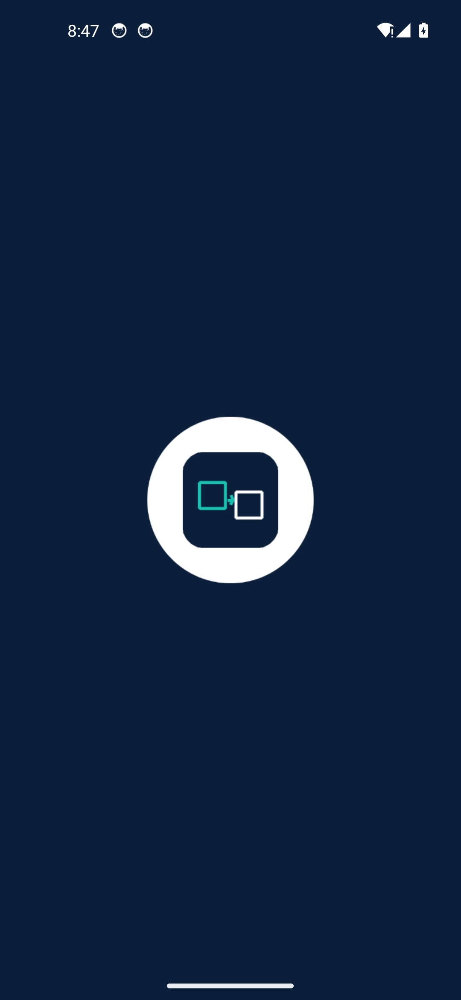 | 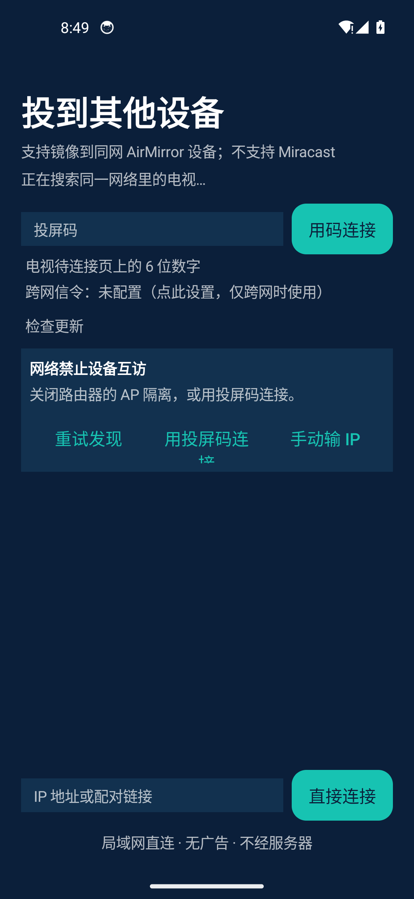 |

| 接收端（393dp） | 引导卡（直角 vs 圆角按钮） |
|---|---|
| 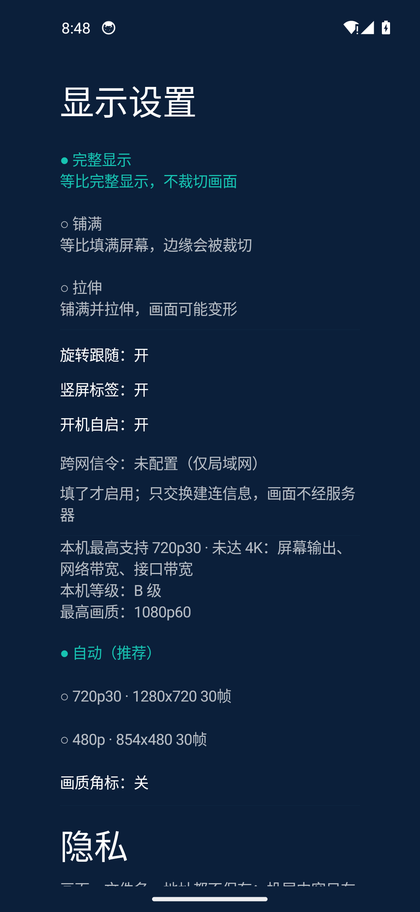 | 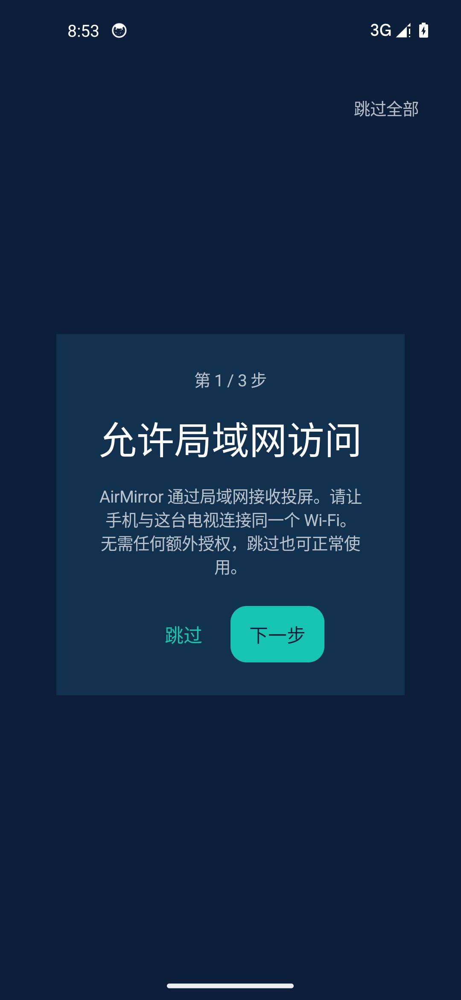 |

| 更新弹窗（系统 AlertDialog） | 显示设置（393dp） |
|---|---|
| 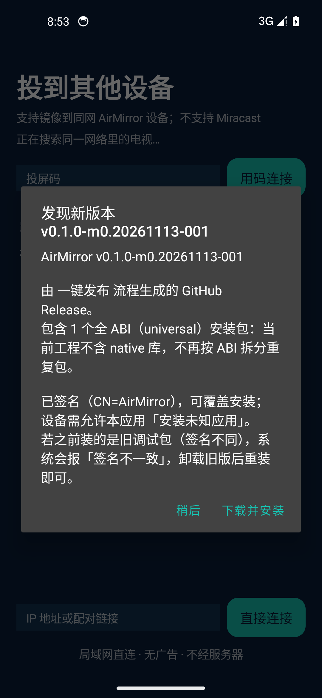 | 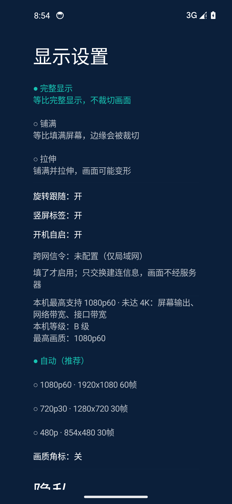 |

| 2K 长屏主入口（480dp） | 2K 长屏接收端（480dp） |
|---|---|
| 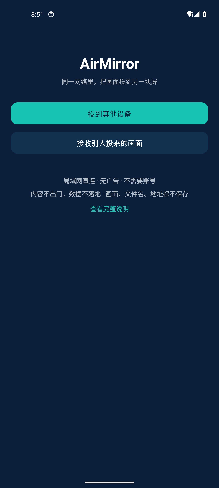 | 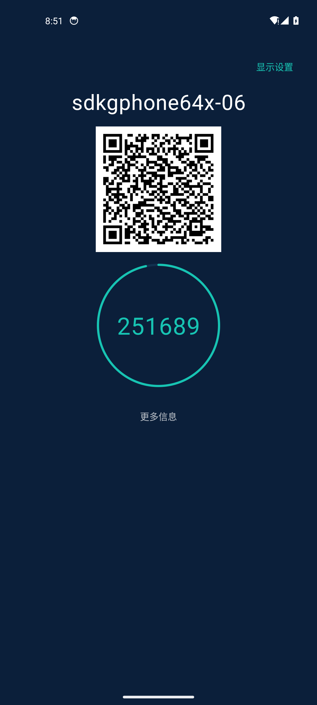 |

### T05759 实施后复核截图

| 393dp 主入口 | 393dp 发送端诊断卡 |
|---|---|
| 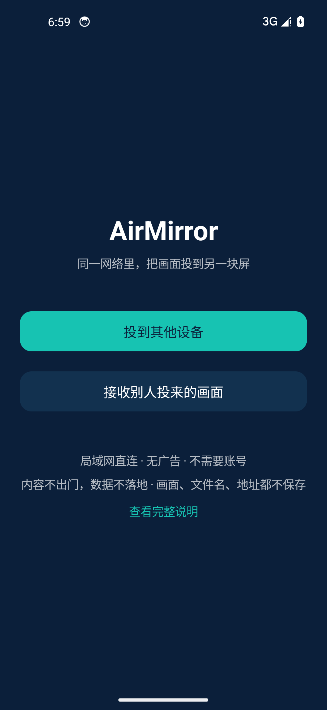 | 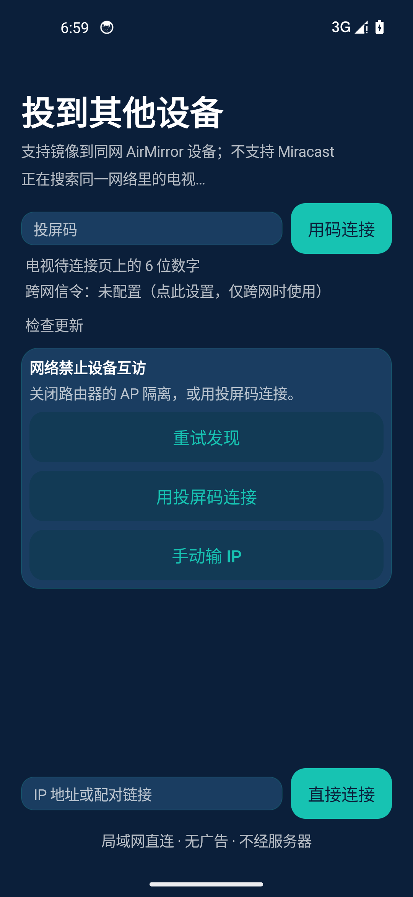 |

| 540dp 主入口 | 540dp 发送端诊断卡 | 540dp 设置 |
|---|---|---|
| 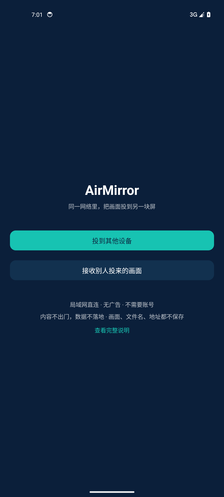 | 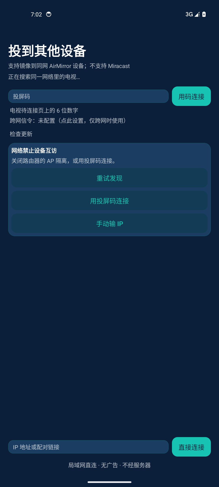 | 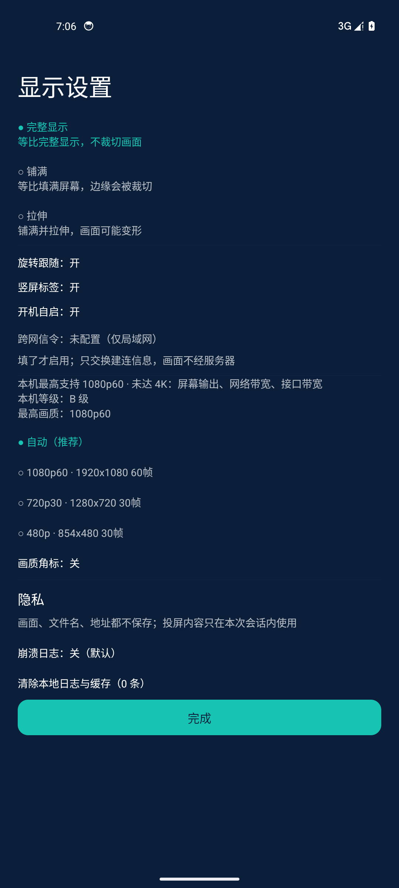 |

| 480dp 主入口 | 480dp 发送端诊断卡 | 480dp 设置 |
|---|---|---|
| 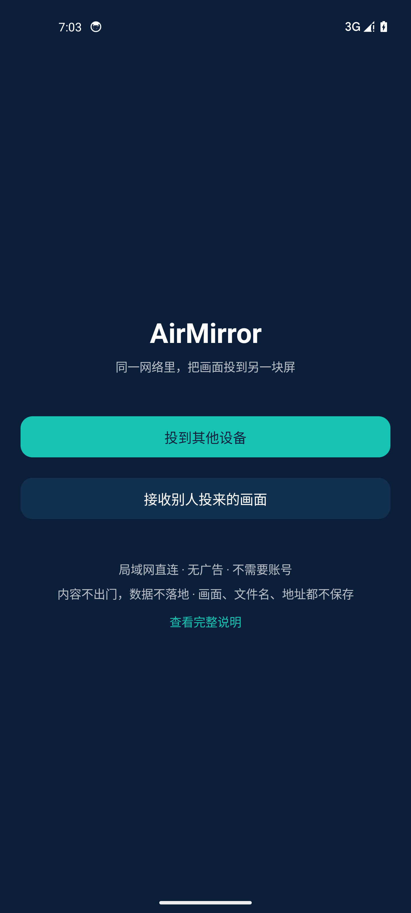 | 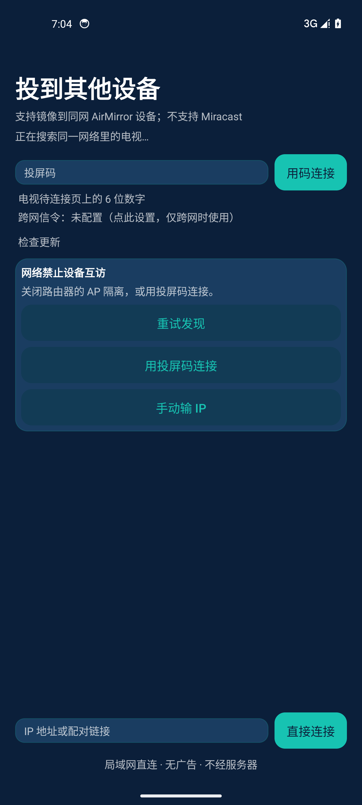 | 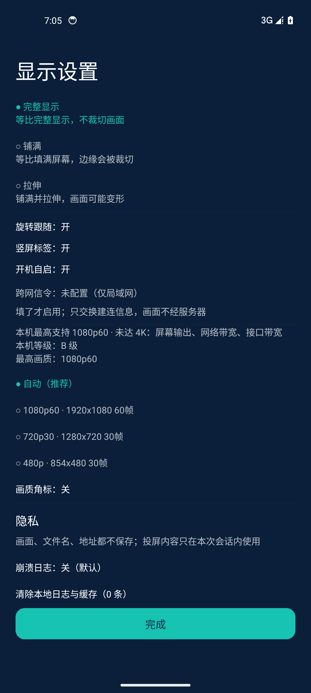 |

| 393dp 设置 | 540dp 更新弹窗（品牌 Material） |
|---|---|
| 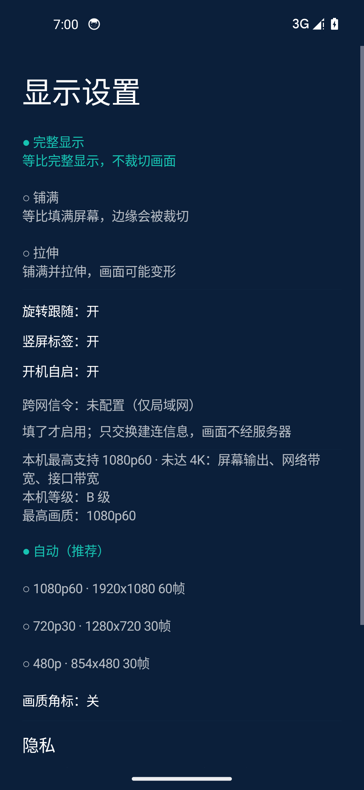 | 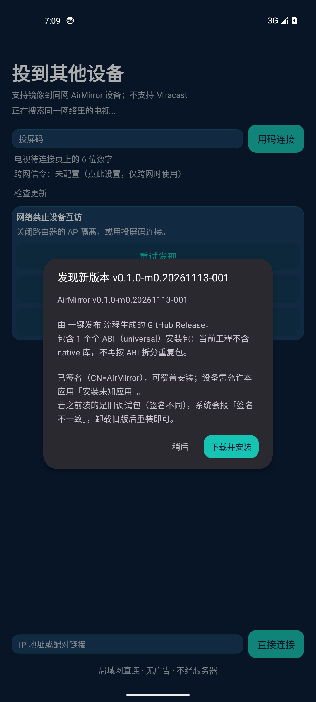 |
