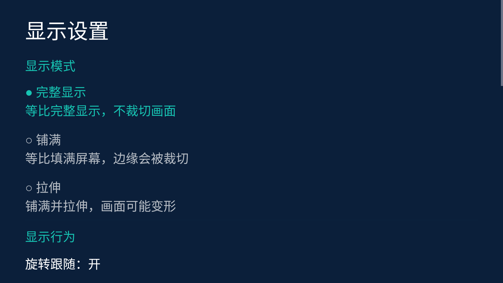
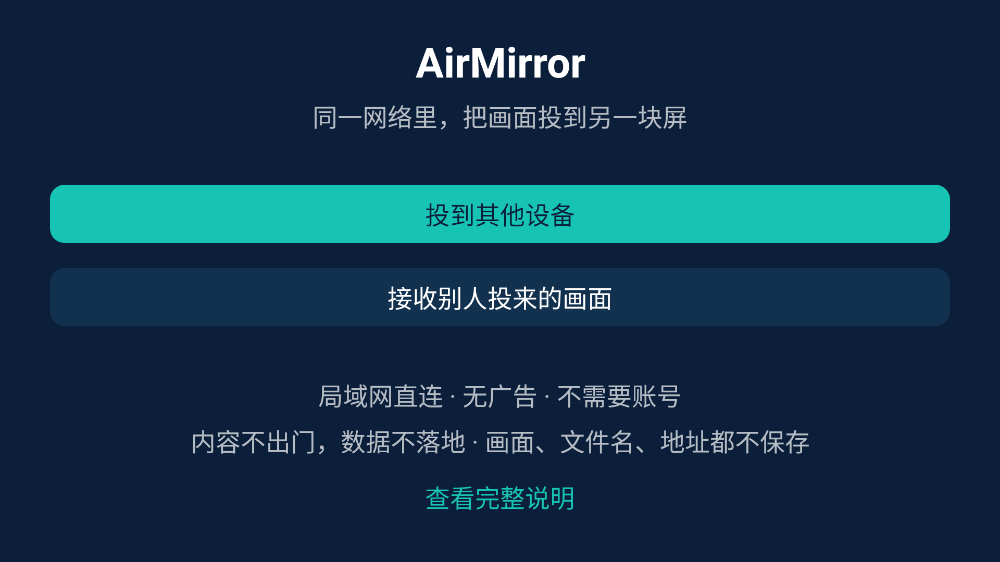

# AirMirror TV 关键页布局设计（T06100）

> 任务：T06100《设计 TV 关键页布局》，关联 REQ-006。
> 结论：1080p / 720p / 4:3 关键页均无裁切，四周安全区不小于 5%，二维码随屏高收敛，
> 6 位码字号随码槽缩放，宽屏 TV 采用“二维码 + 投屏码”并排。焦环 2dp、正文不小于 24px
> 沿用现有令牌；本次用 `TvLayoutSpec` 把这套口径固化为可单测的纯逻辑。

## 1. 验收口径

| 验收项 | 设计口径 | 落地位置 |
| --- | --- | --- |
| 关键页无裁切 | 待连接页、显示设置页、首启入口页在 1920×1080、1280×720、1024×768 下完整显示 | `ReceiverActivity`、`MainActivity` |
| 四周 5% 安全区 | 屏宽、屏高各取 5%，像素向上取整；实际 padding 取“基础留白”与“安全区”的较大值 | `TvLayoutSpec.safeInsets()` |
| 焦点环 2dp | 沿用 `FocusPolicy.OUTLINE_DP=2`，聚焦放大 1.04；不因 TV 布局另设一套焦点样式 | `FocusPolicy`、`TvFocus` |
| 正文不小于 24px | 正文使用 `Theme.BODY_SP=24f`；TV 正文不小于 24sp，在 320dpi 下即 48px | `Theme`、`TvFocus` |
| 二维码自适应 | 码槽边长 = min(基础边长, 屏高 × 34%)；1080p 368px、720p 245px、4:3 262px | `TvLayoutSpec.qrSidePx()` |
| 兼容 4:3 / 16:9 | 宽 ≥500dp 的 TV 并排二维码与投屏码；窄屏与手机仍上下排列 | `TvLayoutSpec.usePairRow()` |
| 6 位码不出环 | 码字号按实际码槽边长同比缩放，避免 4:3 的 262px 码槽仍用 36sp | `TvLayoutSpec.codeSp()` |

## 2. TV 判定与安全区

`TvLayoutSpec.isTvLayout(uiModeTv, widthPx, heightPx)` 的判定为：

1. 系统 `uiMode` 明确为 `UI_MODE_TYPE_TELEVISION`；或
2. 屏幕宽 ≥1024px 且横屏。

第 2 条用于杂牌盒子/部分投影不上报 TV `uiMode` 的场景，避免它们落回手机 14sp 正文排版。

| 分辨率 | 5% 安全区（左右 / 上下） | 实际 padding（左右 / 上 / 下） | 说明 |
| --- | --- | --- | --- |
| 1920×1080 | 96 / 54 px | 96 / 56 / 54 px | 上边沿用 28dp 基础留白 56px，略大于 5% |
| 1280×720 | 64 / 36 px | 64 / 56 / 48 px | 上、下取基础留白，均大于 5% |
| 1024×768（4:3） | 52 / 39 px | 64 / 56 / 48 px | 左右沿用 32dp 基础留白 64px，大于 5% |

实际 padding 只增不减：安全区是下限，既有视觉留白不被压扁。

## 3. 关键页布局

### 3.1 待连接页

结构固定为三件直接子件，避免静态守卫把并排/竖排分支误判成重复挂载：

1. `nameRow`：品牌标记 `A` + 设备名“客厅电视”。
2. `visualRow`：二维码与 6 位投屏码码槽。宽屏 TV 横排（间距 24dp），手机/竖屏纵排（间距 16dp）。
3. `pinArea`：PIN 模式开启时替换 `visualRow` 的位置，沿用同一主视觉区节奏。

二维码与码槽同边长：1080p 368px、720p 245px、4:3 262px。并排内容宽度分别为
784px、538px、572px，均小于对应安全区可用宽度（1728px、1152px、896px）。

6 位码字号：1080p 约 34.86sp、720p 约 23.21sp、4:3 约 24.82sp；手机 156dp 码槽保持
36sp。字号只缩不放，确保不顶出圆环，同时 24sp 下限由正文令牌兜底。

### 3.2 显示设置页

标题、显示模式行、显示行为行均落在 96px 左右安全区与 54px 上下安全区内；正文使用
24sp 以上字号，设置项整行可聚焦，聚焦环 2dp。设置面板不铺满屏幕，避免电视边缘被
HDMI overscan 吃掉。

### 3.3 首启入口页

AirMirror 标题、两个主按钮与“数据边界”入口使用 96 / 64 / 54px 内边距；按钮高度与
正文不小于 24sp，保证 3 米观看距离可读。入口页不引入额外装饰层，保持纯白/深色主题
切换时结构一致。

## 4. 多分辨率渲染证据

以下截图由 `TvLayoutUiTest` 用 Robolectric NATIVE 图形模式按真实像素布局后生成，
不是设计稿占位图。

### 1920×1080 待连接页

### 1920×1080 显示设置页

### 1920×1080 首启入口页

### 1280×720 待连接页

### 1024×768（4:3）待连接页

## 5. 代码落点

| 文件 | 改动 |
| --- | --- |
| `app/src/main/java/io/github/wangnan05563/airmirror/ui/TvLayoutSpec.kt` | 新增：TV 判定、5% 安全区、二维码收敛、码字号缩放、并排阈值 |
| `app/src/main/java/io/github/wangnan05563/airmirror/ui/TvFocus.kt` | `isTvMode` 增加“大横屏兜底”，不改变原有 TV 字号/焦点令牌 |
| `app/src/main/java/io/github/wangnan05563/airmirror/ui/ReceiverActivity.kt` | 待连接页/设置页安全区；`visualRow` 单次挂载；并排/竖排切换；码字号缩放 |
| `app/src/main/java/io/github/wangnan05563/airmirror/ui/MainActivity.kt` | 入口页 TV 安全区 padding |
| `app/src/test/.../ui/TvLayoutSpecTest.kt` | 5 项纯逻辑测试：安全区、二维码、码字号、并排阈值、TV 判定 |
| `app/src/test/.../ui/TvLayoutUiTest.kt` | 5 项真实像素布局测试 + 5 张截图 |
| `app/src/test/.../ui/MainVisualGuardTest.kt` | 静态守卫收敛为 3 个直接子件，检查 `visualRow` 内部二维码/码槽 |
| `app/src/test/.../ui/CodeFadeGuardTest.kt` | 配合旧路标记清理，`codeTextSp` 改名 `codeFontSp` |
| `app/src/test/.../ui/PinAccessUiTest.kt` | PIN 用例前置清空 PIN 快照，消除同进程跨用例污染 |

## 6. 验证与边界

- 定向：`TvLayoutSpecTest` 5 项、`TvLayoutUiTest` 5 项，共 10 项全通过；5 张截图均生成。
- 受影响回归：`TvLayoutSpecTest`、`TvLayoutUiTest`、`PinAccessUiTest`、`MainVisualGuardTest`、
  `CodeFadeGuardTest` 共 5 类 / 28 项 / 0 失败。
- 全量：`./gradlew :app:cleanTest :app:testDebugUnitTest --offline`，项目累计 113 类 / 849 项，
  0 失败（T06100 新增 2 类 / 10 项，基线 111 类 / 839 项）。
- 未覆盖：真实电视 HDMI overscan 与电视自身缩放、真实 D-pad 焦点顺序、TalkBack、
  断电重启后的 PIN 锁定恢复、4:3 物理面板观感，统一交给 T06115《M2 联调与 Win 测试》
  在真实 Win10/11 主机 + 电视上验收。本设计保证的是“按 Android 像素布局不裁切”，
  不等于所有电视的 overscan 都恰好为 5%。
