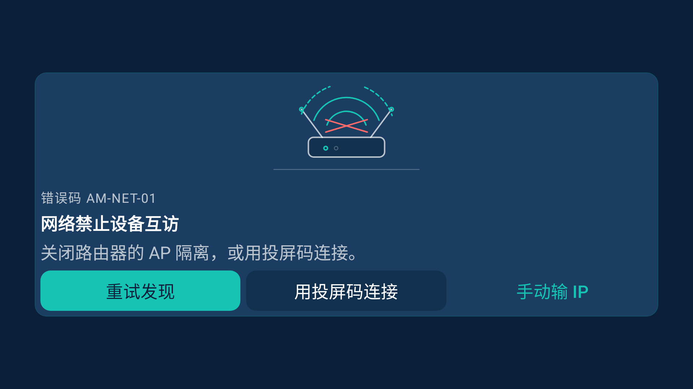
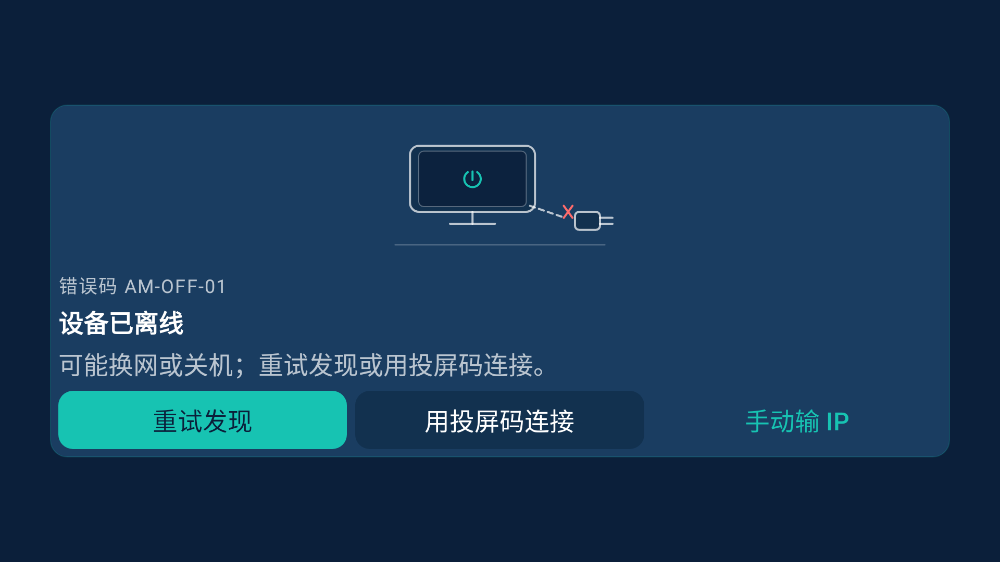

# AirMirror 错误状态插画设计（T06101）

| 项 | 内容 |
| --- | --- |
| 任务 | T06101《绘制错误状态插画》 |
| 关联 | REQ-007；PRD `docs/AirMirror-优化PRD-v2.0-20261121.md` §FR-2.0-07（UI-02） |
| 前置 | T06100 已完成（5% 安全区、TV 判定、720p/1080p/4:3 布局口径） |
| 日期 | 2026-11-23 |
| 结论 | 三套纯 Canvas 插画 + 可复用 `ErrorStateCard` + 10 秒加载口径；不引入位图，14 项定向测试通过 |

## 01 交付边界

本单交付**视觉稿与可复用组件**：`ErrorIllustrationView` 负责三套代码绘制插画，`ErrorStateCard` 负责“插画 → 错误码 → 原因 → 下一步 → 主/次/兜底按钮”的卡片结构。

按依赖链，页面级接入（替换 `SenderActivity` 现有空态卡、首次连接加载态、取消按钮）由 **T06104《开发空态视觉组件》** 完成。本单不改 `EmptyDiagnosis` 的固定三动作与判决优先级，避免视觉层反向改业务规则。

## 02 三套插画

| 场景 | 触发原因 | 错误码 | 画面语言 | 原因一句话 | 主 / 次 / 兜底 |
| --- | --- | --- | --- | --- | --- |
| 无设备 | `NO_DISCOVERY`；或空列表无命中 | `AM-ND-01` | 空电视 + 三点空白 + 右上虚线搜索波纹 | 列表里没有设备 | 重试发现 / 用投屏码连接 / 手动输 IP |
| 网络异常 | `DISCOVERY_AP_ISOLATED`、`DISCOVERY_DUAL_BAND`、`UNREACHABLE` | `AM-NET-01` / `AM-NET-02` / `AM-NET-03` | 路由器 + 天线 + 断开的 Wi-Fi 弧 + 红色斜杠 | 网络禁止设备互访 / 不在同一频段 / 连不上对方设备 | 重试发现 / 用投屏码连接 / 手动输 IP |
| 接收端离线 | `DEVICE_OFFLINE` | `AM-OFF-01` | 空电视 + 电源符号 + 断开的电源线与插头 | 设备已离线 | 重试发现 / 用投屏码连接 / 手动输 IP |

三套画法共用同一套线性语言：电视/路由器轮廓 2dp 描边、卡片内浅色面、青绿表示“可用通道”、红色只用于“断开/禁止”的短斜杠。插画不承担文案，原因和下一步始终来自 `ErrorNotice.noticeFor(cause)`，避免同一件事两套说法。

### 2.1 1080p 视觉稿

**无设备**：空屏三点表示“没有可选项”，右上虚线波纹表示“还在找”，不是“已连接”。

**网络异常**：Wi-Fi 第三圈断开并叠红色斜杠，明确区分“网络有问题”和“没有设备”。

**接收端离线**：电源符号在屏内，电源线在插头前留缺口并打叉，和“设备已离线/可能关机”文案同义。

### 2.2 尺寸矩阵

| 场景 | 360dp | 720p | 1080p |
| --- | --- | --- | --- |
| 无设备 | [360dp](assets/error-states-20261123/error-no-device-360dp-20261123.png) | [720p](assets/error-states-20261123/error-no-device-720p-20261123.png) | [1080p](assets/error-states-20261123/error-no-device-1080p-20261123.png) |
| 网络异常 | [360dp](assets/error-states-20261123/error-network-360dp-20261123.png) | [720p](assets/error-states-20261123/error-network-720p-20261123.png) | [1080p](assets/error-states-20261123/error-network-1080p-20261123.png) |
| 接收端离线 | [360dp](assets/error-states-20261123/error-offline-360dp-20261123.png) | [720p](assets/error-states-20261123/error-offline-720p-20261123.png) | [1080p](assets/error-states-20261123/error-offline-1080p-20261123.png) |

矩阵在 `TvLayoutSpec.safeInsets` 的 5% 安全区内渲染：360dp 为 720×1280、720p 为 1280×720、1080p 为 1920×1080；卡片在安全区内上下居中，断言卡顶/卡底均不越界。720p 卡片内动作区额外断言 `actionsBar.bottom <= card.height - paddingBottom`，修复了初版按钮圆角被卡底裁掉的问题。

## 03 卡片与按钮层级

`ErrorStateCard` 的固定结构：

1. 装饰插画：`ErrorIllustrationView`，`A11y.decorative(this)`，TalkBack 不读；
2. 错误码：`错误码 AM-XX-NN`，给用户报障，不显示异常类名/堆栈；
3. 原因一句：`ErrorNotice.headline`，加粗；
4. 下一步一句：`ErrorNotice.nextStep`；
5. 三动作：沿用 `EmptyDiagnosis.ACTIONS` 的固定顺序，第一枚 Primary、第二枚 Secondary、其余 Ghost。

| 层级 | 视觉 | 现有动作 | 语义 |
| --- | --- | --- | --- |
| 主按钮 | 青绿实底 `Theme.ACCENT` | `RETRY_DISCOVERY` | 立即重起搜索；不是“知道了” |
| 次按钮 | 面底 `Theme.SURFACE` | `ENTER_CODE` | 就地聚焦投屏码输入 |
| 兜底 | 透明底 + 青绿字 `Theme.ACCENT` | `ENTER_IP` | 手动 IP，保证任何错误态都有第三条路 |

按钮最小高度手机 48dp、TV 56dp；卡内紧凑模式只在手机压缩字号，TV 保持 24sp 按钮字，避免 720p/1080p 为塞进横排而牺牲可读性。360dp 下三按钮同排，文案单行不截断。

## 04 首次连接加载与 10 秒取消

加载态规则已收敛为纯逻辑 `ErrorVisualSpec.loading(deviceName, elapsedMs)`，宿主接入在 T06104：

| 时间 | 文案 | 取消入口 |
| --- | --- | --- |
| `< 10s` | `正在连接{设备名}…` | 不显示 |
| `>= 10s` | `仍在连接{设备名}…` | 显示“取消” |

- 设备名 `trim()` 后最多保留 20 字符；空名回退“接收端”，避免空白。
- 10 秒是阈值本身，`elapsedMs == 10_000` 即切换，不是第 11 秒。
- 取消复用发送端已有的 `CaptureService.ACTION_STOP` 停止通道，不新增第二套停止协议。
- 加载态首次连接就有文案，不允许空白；错误/空态与加载态互斥，由宿主按连接状态切换。

## 05 无障碍、主题与性能

- **TalkBack**：插画 `IMPORTANT_FOR_ACCESSIBILITY_NO`；原因/下一步是普通文本；按钮描述走 `A11yCopy.diagnosisRetry/diagnosisCode/diagnosisIp`，读屏可读出原因和三个动作，不读装饰图。
- **对比度**：只用 `Theme` 令牌——`TEXT_SECONDARY`（70% 白）作 2dp 主线、`ACCENT` 作可用通道、`DANGER` 只作短斜杠、`SURFACE_ELEVATED` 作卡面。深蓝 `#0B1F3A` 与纯黑 OLED 上主线/强调线均保持高对比；不引入浅灰小字承载关键信息。
- **无位图**：`ErrorIllustrationView` 只使用 `Canvas.drawLine/drawRoundRect/drawArc/drawCircle/drawPath`，没有 `Bitmap`、`R.drawable`、`BitmapFactory`；源码守卫在 `ErrorIllustrationViewTest`。
- **首屏成本**：三套插画共用一个 `View` 类，按 `kind` 切换路径，不预加载三张图；绘制是常数级路径，不增加首屏 I/O。

## 06 触发映射与集成注意

| 生产入口 | 现状 | T06104 接法 |
| --- | --- | --- |
| 已知设备全部离线 | `EmptyDiagnosis.of` 返回 `DEVICE_OFFLINE` | 绑定 `ErrorStateCard(DEVICE_OFFLINE)`，离线插画 |
| 搜索结束无命中且 AP 隔离/双频 | 返回 `DISCOVERY_AP_ISOLATED` / `DISCOVERY_DUAL_BAND` | 绑定网络插画，错误码 `AM-NET-01/02` |
| 搜索中且 0 台 | `EmptyDiagnosis.of` 返回 `null`，当前没有 `NO_DISCOVERY` 的自动产出 | 在空列表“搜索中”态显式传 `NO_DISCOVERY`，或由 T06104 的空态组件提供无设备入口；不要改 `EmptyDiagnosis` 固定三动作 |
| 连接失败/不可达 | `ErrorNotice.Cause.UNREACHABLE` | 可复用网络插画；码过期/PIN 等仍用各自文字卡，不硬套插画 |

`ErrorStateCard` 只对三类场景显示插画；`sceneFor` 返回 `null` 的其他原因会隐藏插画，退化为文字卡，避免“码过期”配一张路由器图。

## 07 验收与证据

| 验收项 | 结果 |
| --- | --- |
| 三套插画均为代码绘制，不引入位图 | `ErrorIllustrationViewTest` 5 项通过；源码扫描 0 个 `Bitmap`/`R.drawable` |
| 三套在 360dp/720p/1080p 无截断 | `ErrorStateCardUiTest` 3 项通过，9 张 PNG 落盘；卡顶/卡底/动作区三重边界断言 |
| 每套有原因 + 主按钮 + 次按钮 + 兜底 | `ErrorStateCardUiTest` 断言 3 个动作、主/次/兜底背景色、最小触控高度 |
| 错误码可见且不是异常类名 | 断言 `错误码 AM-ND-01` 等；可见文案不含 `Exception`/`java.`/`at io.` |
| 10 秒加载口径 | `ErrorVisualSpecTest` 6 项：9999ms 不取消、10000ms 显示“仍在连接”+取消 |
| 装饰图不读 | `ErrorIllustrationViewTest` 断言 `IMPORTANT_FOR_ACCESSIBILITY_NO` |
| 720p 卡片内部不裁切 | 初版复现并修复：TV 屏高 ≤400dp 时插画高度收到 120dp；断言动作区不越过卡片内边界 |

定向测试：`ErrorVisualSpecTest` 6 + `ErrorIllustrationViewTest` 5 + `ErrorStateCardUiTest` 3 = **14 项 / 0 失败**。9 张截图均从同一套 `ErrorStateCard` 真实渲染，不是手绘示意图。

全量回归：`./gradlew :app:testDebugUnitTest` 共 **116 类 / 863 项，859 通过、4 失败**；本单 3 类 14 项全部通过。4 项失败集中在 `ApkDownloadTest` 1 项（`.part` 改名瞬时占用）与 `BrowserCastServerTest` 3 项（临时 mp4 删除/残留），单类重跑仍复现，均未触达本单代码路径；D 盘满载导致的 7 项截图写入失败已通过把 `build/` 重定向到 C 盘消除，`PinAccessUiTest` / `TrustSettingsUiTest` / `TvLayoutUiTest` 复跑 14 项全过。

## 08 代码落点

| 文件 | 作用 |
| --- | --- |
| `app/src/main/java/io/github/wangnan05563/airmirror/ui/ErrorVisualSpec.kt` | 场景映射、稳定错误码、主/次/兜底角色、10 秒加载纯逻辑 |
| `app/src/main/java/io/github/wangnan05563/airmirror/ui/ErrorIllustrationView.kt` | 三套 Canvas 插画；2dp 线宽、Theme 令牌、装饰图移出无障碍树 |
| `app/src/main/java/io/github/wangnan05563/airmirror/ui/ErrorStateCard.kt` | 可复用错误卡；错误码/原因/下一步/三动作；`onAction` 由宿主就地处理 |
| `app/src/test/java/.../ErrorVisualSpecTest.kt` | 6 项纯逻辑 |
| `app/src/test/java/.../ErrorIllustrationViewTest.kt` | 5 项绘制与无位图守卫 |
| `app/src/test/java/.../ErrorStateCardUiTest.kt` | 3 项矩阵截图与边界断言 |

## 09 边界与未做

- 不改 `SenderActivity` 现有 `diagnosisCard` 结构；其 3 个反射字段、`EmptyDiagnosisGuardTest` 源码串与 `AccessibilityManifestTest` 的 12 个监听基线保持原样，留给 T06104 统一替换。
- 不做第四套插画；码过期、PIN、权限等错误继续用现有文案卡。
- 真电视 HDMI overscan、OLED 纯黑、TalkBack 线性顺序与遥控器焦点顺序仍需 T06115/T06104 现场复验；本单只证明 JVM 真实像素渲染与代码绘制路径。
- 不新增位图/矢量资源，不引第三方图标库；APK 资源表无新增条目。
